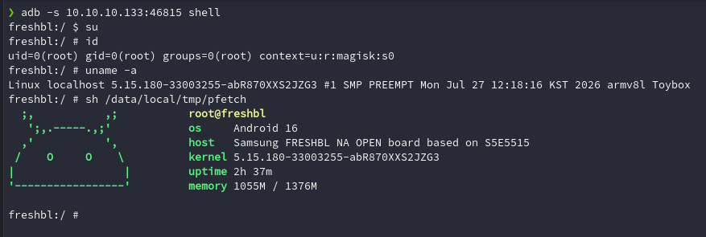

# Galaxy Watch 4 (SM-R870): root via DirtyFrag and Magisk

Notes, binaries and sources for rooting a Samsung Galaxy Watch 4 (SM-R870) on firmware `R870XXS2JZG3`.

The root path uses a kernel page-cache write primitive (DirtyFrag, CVE-2026-43284) to load a small kernel module. The module's bootstrap writes a Magisk-patched boot image to the boot partition, and Magisk then provides root.

> **Warning.** This procedure overwrites the boot partition without a backup and needs an unlocked bootloader. A bad boot or a damaged `/data` partition can leave the watch unusable without hardware recovery. Keep a copy of the stock firmware before starting.

## Status

Verified on an SM-R870, build `BP2A.250325.020.R870XXS2JZG3`, kernel `5.15.180-33003255-abR870XXS2JZG3`:

- The Magisk 31.1 boot image written by the chain boots, and `magiskd` runs from the ramdisk.
- `su -c id` from the ADB shell returns `uid=0(root)` with context `u:r:magisk:s0`.

Verified values and artifact hashes are in `docs/STATUS.md`. Pitfalls and open questions are in `docs/LESSONS.md`.

## Requirements

- Samsung Galaxy Watch 4 (SM-R870) on firmware `R870XXS2JZG3`. The binaries here match only this build.
- An unlocked bootloader.
- A computer with `adb` (Android platform-tools) on the same Wi-Fi network as the watch, with wireless debugging enabled on the watch.
- The Magisk 31.1 APK (version code 31100) from <https://github.com/topjohnwu/Magisk/releases>. It is not included in this repository.

## Procedure

The step-by-step procedure with commands is in `SKILL.md`.

## Repository layout

| Path | Contents |
|---|---|
| `bin/` | Prebuilt chain binaries and `classes.dex`, for firmware `R870XXS2JZG3` |
| `src/` | Sources: the ARM32 shellcode, the exploit, the ARM64 kernel module, `DirtyFragSetup.java`, `splicehelper.c` and the bootstrap script |
| `apk/` | `gw4-adb-keeper.apk`: enables wireless debugging after boot. It needs `WRITE_SECURE_SETTINGS`, granted with `pm grant` |
| `adbkeeper/` | Sources of the adbkeeper APK and `build.sh`, which builds it from `ANDROID_SDK`. See `docs/BUILDING.md` |
| `docs/STATUS.md` | Verified state, versions and artifact hashes |
| `docs/LESSONS.md` | What worked, pitfalls, unresolved questions and where the full knowledge lives |
| `docs/BUILDING.md` | Rebuilding from source, needed after a firmware change |
| `SKILL.md` | The step-by-step procedure, in the form used by the Claude Code skill |

## Limitations

- No backup. The bootstrap writes `magisk-boot.img` to `/dev/block/by-name/boot` with `dd` and does not back up the old image first. Keep the stock image (SHA-256 `026bf467…`) and the Magisk image.
- Do not flash `boot.img` through NetOdin or Brokkr over Wi-Fi. SVB rejects unsigned boot images. This procedure uses neither Odin nor download mode.
- Vbmeta is not patched. The watch boots only because the bootloader is unlocked.
- Every full system reflash removes the Magisk boot image and root. The procedure has to be repeated.
- Restoring the vendor library in the page cache can fail. A reboot clears it.

## Rebuilding

The binaries in `bin/` work only with the same firmware version. After a firmware change, follow `docs/BUILDING.md`.

## Credits

- [DFRoot](https://github.com/diabl0w/DFRoot), the reference implementation of the same chain on arm64 devices. The SELinux and DEFEX handling here follows it.
- [Magisk](https://github.com/topjohnwu/Magisk) by topjohnwu.

## Disclaimer

No warranty. Use at your own risk.
